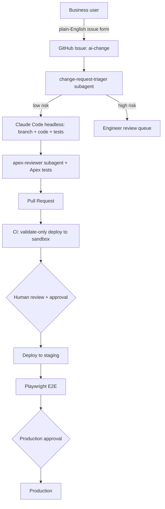
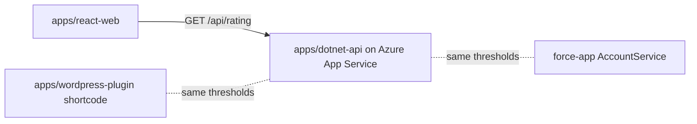

# Architecture

## Goal
Let non-technical teams propose Salesforce changes in plain English while engineering
quality, security and approvals stay intact.

## Flow

## Components
| Layer | Implementation |
|---|---|
| Agent environment | `.claude/` (agents, commands, hooks, settings), `CLAUDE.md`, `.mcp.json` |
| Guardrails | PreToolUse hook blocks non-sandbox deploys; scoped `--allowedTools` in CI |
| CI/CD | `.github/workflows/` (GitHub Actions); `azure-devops/` equivalent |
| Testing | Apex unit tests (local), Playwright E2E (staging) |
| Governance | Branch protection, GitHub Environments with required reviewers |

## Trust boundaries
- The agent only ever sees sandbox credentials. Production auth lives in a CI secret
  scoped to the `production` environment.
- The agent can open PRs but cannot merge or deploy.
- Request text, issue comments and record data are untrusted input. They can describe a change; they
  cannot instruct the agent, change a tier or unlock a guardrail.
- Autonomy is tiered (T0-T3, see `docs/governance.md`). The triager sets the tier from the request
  and `docs/org-profile.md`; T2 stops at a design proposal and T3 is never automated.

## Scaling to more orgs and clients
- Nothing in the agent layer assumes folder names or one org. Stacks are discovered per repo, and
  each client repo carries its own `docs/org-profile.md`, sandbox alias and allowlist.
- Multiple orgs or sandboxes: set `SF_ALLOWED_ORG_ALIASES` per repo and name the test alias in the
  org profile; the org-type check in `scripts/org-test.sh` still applies to each.
- Larger programs: split into one package directory per domain in `sfdx-project.json`; the verify
  loop and reviewers follow whatever `detect-stacks.py` reports.

## Multi-stack layout

| App | Stack | CI check | Deploy target |
|---|---|---|---|
| `force-app/` | Salesforce Apex/LWC | `sf project deploy validate` + Apex tests | sandbox -> staging -> production (gated) |
| `apps/dotnet-api/` | .NET 8 minimal API | `dotnet test` | Azure App Service `staging` slot, swap gated |
| `apps/react-web/` | React + Vite | Vitest + build | static hosting (add per environment) |
| `apps/wordpress-plugin/` | PHP plugin | `php -l` + unit test | WordPress staging site |

Each app has a path-filtered GitHub workflow, plus one Azure DevOps pipeline
(`azure-devops/azure-pipelines.yml`) with per-app stages and a gated production stage.
The rating thresholds are a deliberate cross-stack invariant, verified end to end by
`tests/e2e/cross-system.spec.ts`.
